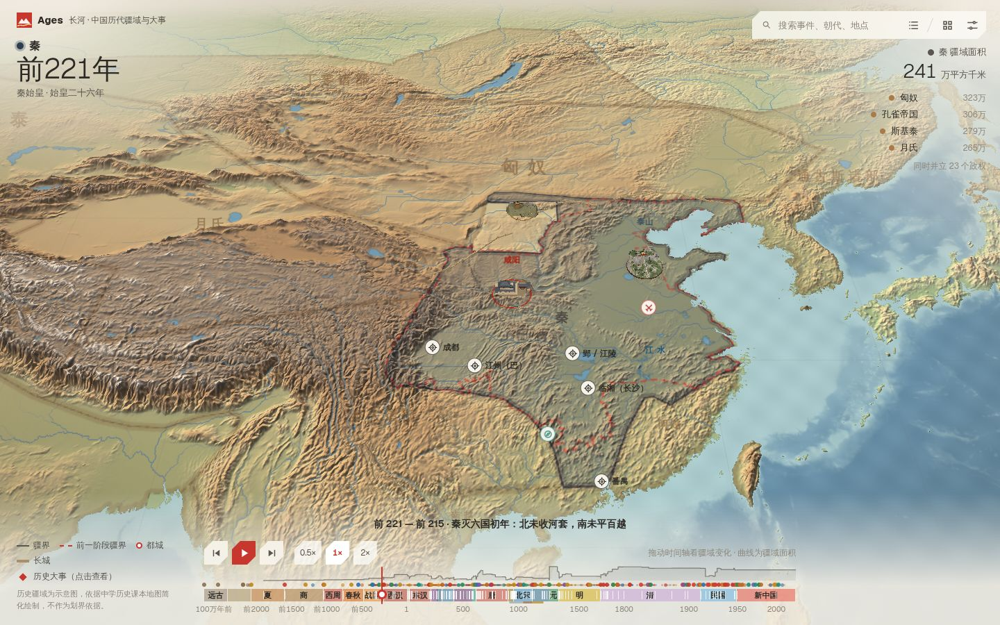
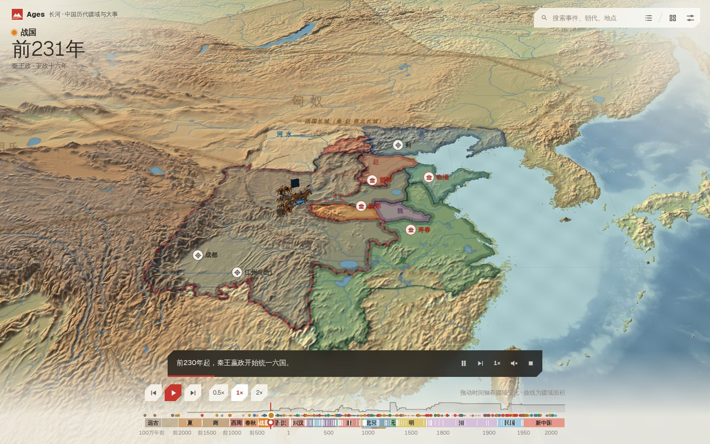
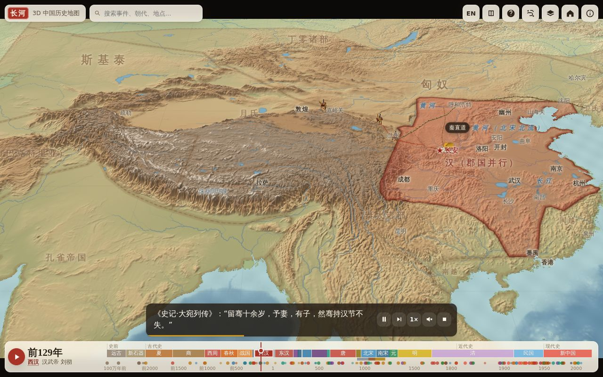
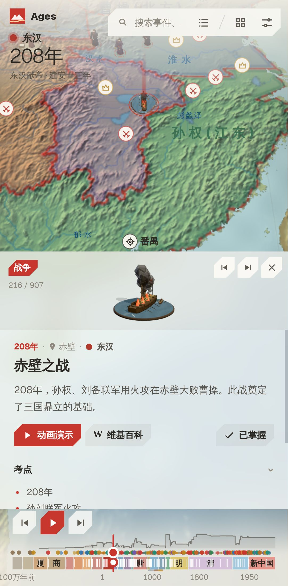

# 长河 Ages · 3D Atlas of Chinese History

**Live:** https://huangyingting.github.io/ages/

A bilingual (中文 / English), animated 3D atlas for learning Chinese history at middle-school and high-school level. Drag the timeline from the Stone Age to today and the territory map repaints itself on a real terrain relief. Tap an event to read its key points and the textbook units it belongs to. Press **Play** to watch the event unfold: armies march, walls and canals build themselves, and fleets sail across the map. Procedural 3D models (palaces, chariots, treasure ships, steam trains, rockets) mark each event, and Wikipedia sits one click away for background reading.

It is an original 3D re-imagining inspired by [jiangshan-map](https://github.com/DeanChensj/jiangshan-map) and does not reuse its code. **Phase 1** covers Chinese history; **phase 2** will add world history (see [docs/product/roadmap.md](docs/product/roadmap.md)).

| Desktop | Story animation | Journey | Mobile |
|---|---|---|---|
|  |  |  |  |

## Features
* **3D terrain relief** of East Asia, generated from open elevation data, with rivers and coastlines, in paper, ink or plain styles. Zoom in close and finer relief (down to ~40 m per pixel) streams in for the area in view; models and labels grow as you zoom.
* **Timeline** spanning about 1 million years. It is non-linear, so dense periods get more room, and shows era bands, event dots, age headings, drag/keyboard scrubbing and auto-play. **173 territory snapshots** (Xia → PRC; dated phases from 403 BCE to 1949 imported from jiangshan-map) crossfade as the year changes (borders stay crisp when you zoom in), and capitals, period place names (长安 / 西安, 汴京 / 开封 …), polity labels, admin divisions, walls, canals and routes follow the year. The readout shows the reign era (年号, e.g. 北宋神宗 · 元丰八年), with rival regimes' eras on hover.
* **Full-screen map**: the 3D terrain fills the window and every panel floats over it.
* **907 events**: 151 curriculum events plus 756 chronicle entries from jiangshan-map. Each curriculum event has a bilingual summary, key points (考点), people, location and its units in the textbooks (七年级上/下, 八年级上/下, 高中《中外历史纲要（上）》), plus a procedural 3D model.
* **41 scripted story animations, acted out in 3D**: sand-table miniatures act it out on the map — foot and horse formations led by a mounted general march and clash under their standards (troop types — chariots, archers, cavalry, firearms — equipped by era, and named formations such as 锋矢阵 wedge, 鹤翼阵 wings and 圆阵 circle on a battlefield with camps, arrow volleys, trebuchets or cannon), people dressed in their era's costume, cinematic camera shots (low, push-in, crane, shake), defenders hold the gate in sieges and the victor's flag goes up over it, fleets sail with wakes, conquests spread across the map as a glowing front, banners rise over captured cities, and the camera follows, orbits and cuts to cinematic title cards. Walls, canals, railways and fireworks round them out. They have bilingual captions, optional narration (Web Speech), pause / skip / speed controls, and the playhead drives the timeline. All other events get an automatic mini-story staged by kind (a battle for wars, a model and orbit otherwise).
* **7 journeys** (秦始皇统一, 张骞通西域, 诸葛亮北伐, 玄奘西行, 李白, 苏轼, 王阳明): the traveller crosses the map stop by stop, with what happened there and a quote from the sources.
* **Places and people**: click a place for its names through the ages, capital years, lore and nearby events. 113 historical figures have cards linking to their events and journeys, and each period card has an overview and key figures. Search finds old names (汴梁 → 开封), aliases (苏东坡) and journeys.
* **Hover and select on the map**: the dynasty's people, buildings, customs and foods, the capital and event models stand on the map without name plates, and events show as small kind-glyph badges. Point at any of them for a tooltip (name and subtitle), a 3D grow and a glowing ground ring; click to open its card; the map flies there and a ring marks what is selected. With the administrative layer on, pointing at open land names the prefecture in the same tooltip. That is all: one behaviour for every object, no duplicate badge where a model already stands for an event, and one card per person (a figure standing on the map carries their lifespan, journey and events on that card). Routes, trails and rings are painted on the map as unbroken lines and perfect circles that hills never cut.
* **41 procedural 3D models** built from primitives in Web Workers, with simple rigs (flags flap, wheels spin, smoke rises).
* **Wikipedia reader** in Chinese (简体) or English: lead, sections, image, reading time and a link to the full article. It falls back through interlanguage links and works offline gracefully.
* **History course (历史课堂)**: 31 lessons, one per textbook unit (七上 to 八下 and 高中《中外历史纲要》上), in the style of a geography classroom. Each lesson walks through 5–8 steps that drive the map (year, camera, highlighted polity, event model, ▶ watch), then a 随堂检测 with multiple-choice, time-order and find-it-on-the-map questions, explanations after each answer, a score, take-aways, review links and the next lesson. Each unit also has a unit test, progress is saved locally, and lessons have `#lesson=<id>` links. See [docs/design/course.md](docs/design/course.md).
* **Quiz** in two modes. *History questions* has three types: *when* (pick the year), *where* (click the map; graded by distance) and *order* (sort events). *Ancient places* (古地名定位) asks where a period name was (五代十国时期的「祯州」在哪里？): place names are hidden, you click the map, score up to 100 by distance and earn an official rank (书院童生 → 太史令 · 舆图大家). Every answer is revealed on the map.
* **Chronicle (本时期大事)**: the period details list every event of the dynasty in view — all 907, not just the textbook ones — with a 全部 / 课本 filter, ◆ for map-changing events and ▶ for scripted stories. It follows the timeline and highlights the current year.
* **Period details (时期详情)**: a popover under the toolbar names the territorial phase (e.g. 明 · 06 / 10), with bars to step between phases, its years, capital and area, every coexisting polity with its area (click to fly there, hover to highlight) and a note on what changed; a line key for borders, walls, canals, roads and sea routes sits on the map's lower left. The previous phase's borders show as a dashed red **ghost line**, and moving to the next phase **grows** the new borders out of the old ones, so expansion and loss stand out.
* **Event beam**: the open event stands under a soft light beam rising from its selection ring, so it can be found from far away.
* **Year headline and area curve**: the dynasty, a large year and the reign era head the map's top left; the realm's area (唐疆域面积 584 万平方千米) and the largest coexisting polities sit top right, and a faint curve over the timeline traces the area phase by phase, so rise and fall show at a glance (areas precomputed by `npm run data:areas`).
* **Year stepper**: the timeline has a floating year flag (公元1415年 · 永乐十三年) and ‹ › buttons beside play to step to the previous / next event or phase; click the headline year to type one (1415, -221, 前221, 221 BC). The arrow keys do the same (Shift = ±10 years).
* **Guqin music (雅乐)**: optional background guqin tracks from the settings menu.
* **Modern interface** in three levels, with the full-screen relief map always in view: (1) text set straight on the map over soft scrims — the headline (dynasty · year · reign) top left, one grouped toolbar plate top right — search · **时期详情** | **hub** (tabs: study — course, quiz; journeys) · **settings** (01 map style, 02 layers, 03 sound & display, 04 language, help) — with the period's figures under it, the line key bottom left, the phase line and the timeline bottom centre; (2) two sides whose views stack — on the left, between the headline and the line key, what is being studied (a lesson, the quiz, the card with its live 3D model); on the right, a drawer under the toolbar for the Wikipedia reader; (3) popovers, one at a time (时期详情, hub, settings), and dialogs (the course picker, help). Both sides step aside during stories (captions take the phase line's place), and the camera re-frames itself so the subject stays between them. On phones both are one bottom sheet above the timeline.
* **No anachronistic names**: the map only prints a place name in the years it was actually used (e.g. 西安 only from 1369, 上海 from 1292, 北京 from 1403); before that it shows the period name (长安, 汴京, 燕京 …) or nothing.
* **Map styles**: paper (light relief, default), ink (dark) and plain.
* **Shareable deep links**: `#e=<event>`, `#y=<year>`, `#p=<place>`, `#person=<id>`, `#life=<id>`, `#j=<journey>`, `&lang=zh|en`. The same keys also work in the query string (`?year=1415`).

## Quick start
```bash
npm install
npm run dev            # http://localhost:5173
npm run build          # typecheck + production build → dist/
npm run preview        # serve dist/ on http://localhost:4173
```
The app is fully static: deploy `dist/` to any static host. Pushes to `main` publish to GitHub Pages via `.github/workflows/pages.yml` (built with `BASE_PATH=/ages/`). Only the Wikipedia reader needs network access, and it calls the public MediaWiki API directly from the browser.

## URL flags
| Flag | Effect |
|---|---|
| `?lowfx=1` | low-cost rendering (DPR 1, no antialiasing); useful on old devices and under software GL |
| `#e=<event id>` | open an event, e.g. `#e=zhenghe`, `#e=qin_unify` |
| `#y=<year>` | jump to a year (negative = BCE), e.g. `#y=-221`, `#y=1405` |
| `&lang=zh\|en` | UI and content language (otherwise the saved choice or the browser language) |

## Keyboard
`/` search · `Space` play/pause (story or timeline) · `←`/`→` previous / next event · `R` reset view · `Esc` close or stop · on the timeline, arrow keys step through years (`Shift` × 10).

## Tests
```bash
npm run typecheck
npm test               # Vitest: data integrity, timeline/search/quiz logic, model builders
npm run test:e2e       # Playwright (desktop + mobile); see below for headless Linux
npm run test:all
```
WebGL in containers needs a display and SwiftShader. Run `xvfb-run -a npx playwright test`. The e2e suite saves the screenshots in `docs/assets/screenshots/`.

## Project layout
```
src/shared/data     content: eras, polities, territories, places, events, stories, curriculum (all bilingual)
src/shared/lib      pure logic: timeline axis, search, quiz generation
src/client/scene    three.js: view/camera, terrain, territory painter, labels, fx & particles, atlas composition
src/client/models   procedural model kit, builders, Web Worker baking
src/client/story    story player (runs StoryStep scripts)
src/client/ui       DOM components (timeline, card, reader, learn, quiz, caption, menus)
src/client/lib      i18n, Wikipedia client, storage, deep links, speech
scripts/            fetch-terrain.ts (terrain heightmap), import-jiangshan.ts (jiangshan-map content), compute-areas.ts (territory areas)
docs/               product spec, roadmap, architecture & ADRs, content guide
```
See [docs/README.md](docs/README.md).

## Content and accuracy
Territories from 403 BCE to 1949 come from jiangshan-map, which traces them from Tan Qixiang's *Historical Atlas of China*, CHGIS and other academic sources; earlier periods, 1937–1945 and the PRC are our own schematic simplifications of the textbook maps. All boundaries are for teaching, not authoritative. The app says so in its help panel and footer. Textbook events follow the national middle-school (统编版) and high-school curricula; about 750 further chronicle entries come from jiangshan-map. Corrections are welcome. See [docs/content-guide.md](docs/content-guide.md).

## Credits
* Elevation: [AWS Terrain Tiles](https://registry.opendata.aws/terrain-tiles/) (Mapzen), derived from SRTM, GMTED2010, ETOPO1 and other public-domain sources.
* Background reading: [Wikipedia](https://www.wikipedia.org/), text under [CC BY-SA 4.0](https://creativecommons.org/licenses/by-sa/4.0/), fetched live and attributed in the reader.
* Territories, administrative divisions, chronicle events, settlements, people, journeys, reign eras and great works: imported from [jiangshan-map 江山图](https://github.com/DeanChensj/jiangshan-map) by DeanChensj (GPL-3.0) with `npm run data:jiangshan`. Its CHGIS / Hartwell-derived boundaries remain academic, non-commercial use only. See [NOTICE.md](NOTICE.md).
* Architecture patterns and the low-poly model kit (figures, timber buildings, ships, animals): adapted from the pocket-planet (Terrastra) project.
* Fonts: [Geist / Geist Mono](https://vercel.com/font) (Vercel) under the SIL Open Font License 1.1; Chinese uses the system CJK sans.

## License
GPL-3.0 (see [LICENSE](LICENSE) and [NOTICE.md](NOTICE.md)).
